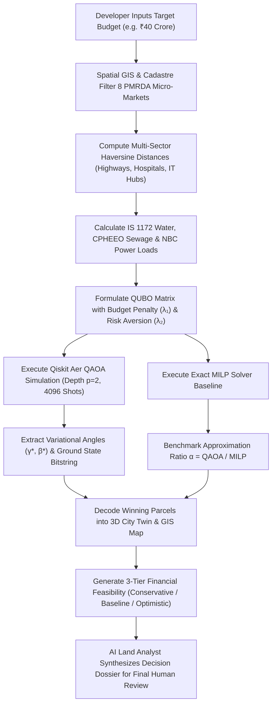

# MASTER ROADMAP — QUANTUM ESTATE X

**Vision**: An integrated Real Estate, Infrastructure, AI and Quantum Computing Intelligence Ecosystem for institutional developers, urban planners, and infrastructure investment funds.

---

## 1. Guiding Product Philosophy & Success Metric

> **The North Star Metric:**  
> **"Can a real estate developer make a better-informed land acquisition or development decision using our platform than they could without it?"**  
> We do not measure success by raw feature counts, decorative visual flair, or vanity quantum claims. Every module, algorithm, and simulation exists to deliver verifiable, scientifically sound decision support.

### The Three Ultimate Outcomes
1. **Outcome 1 — A Usable Product:** A high-utility real estate and infrastructure intelligence platform that developers and investors actually rely on to research land, assess feasibility, and evaluate investments.
2. **Outcome 2 — A Sophisticated Intelligence Ecosystem:** Autonomous AI agents, deterministic civil engineering demand models, 3-tier financial scenarios, interactive 3D digital city twins, and end-to-end workflows.
3. **Outcome 3 — A Serious Quantum Computing Research Platform:** A scientifically rigorous environment for formulating, simulating, and benchmarking quantum algorithms (QAOA, QUBO, Ising) against exact classical solvers (MILP, Simulated Annealing) on real combinatorial land problems.

---

## 2. The 20 Major Development Phases

| Phase | Phase Name | Scope & Deliverables | Current Status |
| :--- | :--- | :--- | :--- |
| **00** | **Environment & Infrastructure** | Dev environment, repository, CI/CD, dependencies, Python & Vite setups | **COMPLETED** |
| **01** | **Core Architecture** | FastAPI backend, React frontend, database schemas, core REST APIs | **COMPLETED** |
| **1.5** | **Quantum Integration** | Qiskit Aer QAOA simulator, QUBO formulation, exact MILP benchmarking | **COMPLETED** |
| **1.6** | **Real Estate Intelligence Studio** | Multi-criteria land search, master parcel profiles, modular feasibility & cash flow | **COMPLETED** |
| **1.7** | **Data Integrity & Validation** | 7-tier Data Trust Framework, WGS-84 boundaries, Overpass API, mathematical safeguards | **COMPLETED** |
| **02** | **Quantum Computing Foundation** | Qiskit Aer C++ engine, 1-8 qubit playground, 14-gate unitary library, Bloch sphere 3D with pure/mixed states, Bell & GHZ entanglement lab, 10 reproducible experiments | **COMPLETED** |
| **03** | **Quantum Mechanics Research Lab** | Multi-qubit density operators, continuous Hamiltonian state evolution $U(t)$, wave interference, Schmidt decomposition, concurrence, PPT negativity, Werner transitions, Qiskit Aer noise models, $T_1/T_2$ decoherence, 3-qubit QEC, and quantum state tomography | **COMPLETED** |
| **1.8** | **Real Geographic Intelligence** | Real Pune GIS, WGS-84/UTM 43N dual projections, NetworkX topological road routing with IRC speeds, RFC 7946 GeoJSON, KDTree spatial index, MCDA suitability scoring | **COMPLETED** |
| **04** | **Advanced Quantum Optimization** | Multi-layer QAOA ($p \le 5$), exact SciPy HiGHS MILP, algebraic QUBO ⇄ Ising proof ($|E_Q - E_I| = 0$), Knapsack/Portfolio/Facility/Resource formulations, 5-way benchmark suite, React 19 Quantum Optimization Lab | **COMPLETED** |
| **05** | **Quantum Machine Learning** | QNN, QSVM, quantum kernel estimation, land valuation classification | **NEXT FOCUS** |
| **06** | **Infrastructure Intelligence** | Road networks, IS 1172 water, CPHEEO sewage, 220kV power grid, infrastructure gap index | **PLANNED** |
| **07** | **Development & Engineering Intelligence**| Construction scheduling, UDCPR 2020 FSI optimization, structural cost modeling | **PLANNED** |
| **08** | **Financial Intelligence** | Capital stack structures, debt-equity sizing, IRR, NPV, multi-year waterfalls | **PLANNED** |
| **09** | **Regulatory & Document Intelligence** | MahaBhulekh 7/12 extraction, title search checks, RERA clearance checklists | **PLANNED** |
| **10** | **Autonomous AI Agent Ecosystem** | Multi-agent collaboration (Research Agent, Finance Agent, Infra Agent, Quantum Agent) | **PLANNED** |
| **11** | **Property Marketplace** | Stakeholder listings, verified institutional listings, land parcel exchange | **PLANNED** |
| **12** | **Digital Twin & City Simulation** | High-fidelity 2D/3D Pune GIS twin (MapLibre GL JS v4+), authentic OSM footprints, zoning & infrastructure overlays, 3D building extrusions | **OPERATIONAL & COMPLETED** |
| **13** | **Advanced Predictive Intelligence** | Micro-market land appreciation forecasting, demand density heatmaps, spatial risks | **PLANNED** |
| **14** | **Portfolio & Investment Optimization** | Multi-property combinatorial allocation, macro risk-return Pareto frontiers | **PLANNED** |
| **15** | **Enterprise Integrations** | Tally, ERP accounting, external geocoding APIs, webhooks, GIS shapefile export | **PLANNED** |
| **16** | **Collaboration & Stakeholder Ecosystem** | Role-based workspaces (Developer, Investor, Planner, Consultant, Researcher) | **PLANNED** |
| **17** | **Security & Enterprise Reliability** | Role-based access control (RBAC), immutable audit logging, enterprise SOC-2 readiness | **PLANNED** |
| **18** | **Testing & Performance Engineering** | Integration testing, load testing, quantum noise modeling, scientific peer review | **PLANNED** |
| **19** | **Final Deployment & Demonstration** | Production cloud deployment, institutional documentation, live flagship demonstration | **PLANNED** |

---

## 3. Seven Core Capability Pillars

```
                     ┌─────────────────────────────────────────────────────────┐
                     │                   QUANTUM ESTATE X                      │
                     │          Intelligent Real Estate Ecosystem              │
                     └────────────────────────────┬────────────────────────────┘
                                                  │
         ┌──────────────────┬─────────────────────┼─────────────────────┬──────────────────┐
         │                  │                     │                     │                  │
┌────────┴─────────┐ ┌──────┴──────────┐ ┌────────┴─────────┐ ┌────────┴─────────┐ ┌───────┴────────┐
│ A. Real Estate   │ │ B. Infra        │ │ C. AI Autonomous │ │ D. Quantum       │ │ E. Financial   │
│    Intelligence  │ │    Intelligence │ │    Analyst       │ │    Laboratory    │ │    Intelligence│
└──────────────────┘ └─────────────────┘ └──────────────────┘ └──────────────────┘ └────────────────┘
                                                  │
                                   ┌──────────────┴──────────────┐
                                   │                             │
                          ┌────────┴─────────┐          ┌────────┴─────────┐
                          │ F. Digital Twin  │          │ G. Marketplace   │
                          │    Simulation    │          │    & Ecosystem   │
                          └──────────────────┘          └──────────────────┘
```

### A. Real Estate Intelligence Platform
- Micro-market land parcel discovery across Pune Metropolitan Region (PMRDA).
- Search by location, budget limits, land area, and zone typology.
- Cadastral validation (IGR Maharashtra / MahaBhulekh 7/12 baseline).
- Standardized acquisition and development cost modeling.

### B. Infrastructure Intelligence
- Spatial proximity to Highways, Hospitals, Universities, Railway Stations, Airports, and IT Hubs.
- Multi-sector accessibility scoring with configurable sector weights.
- Civil utility engineering demand sizing adhering strictly to **IS 1172:1993** (water), **CPHEEO** (sewage), and **NBC 2016** (power).

### C. AI Intelligence (Autonomous Research Assistant)
- Natural language query comprehension (e.g. *"Find residential land around Pune under ₹25 Cr with strong highway frontage"*).
- Automated due diligence synthesis across geographic, utility, and regulatory datasets.
- Multi-agent coordination dividing tasks between Research, Finance, Infrastructure, and Optimization specialists.

### D. Quantum Computing Laboratory
- Quantum gates, circuits, and statevector telemetry running on Qiskit Aer.
- Mathematical formulation of combinatorial land portfolio problems as Quadratic Unconstrained Binary Optimization (QUBO) and Ising spin Hamiltonians.
- Quantum Approximate Optimization Algorithm (QAOA) parameter optimization via SciPy COBYLA.
- Strict classical benchmarking against Exact MILP and Simulated Annealing to evaluate approximation ratios ($\alpha$) without false claims of quantum advantage.

### E. Financial & Investment Intelligence
- Multi-scenario sensitivity modeling (Conservative, Baseline, Optimistic).
- Detailed 3-year phased cash flow schedules (Acquisition, Approvals, Construction, Sales Inflow).
- Gross Development Value (GDV), Net Margins, ROI, and Break-Even Sales Absorption thresholds.

### F. Digital Twin & City Simulation
- Three-dimensional WebGL rendering of Pune Metropolitan Region parcels and surrounding morphology.
- Interactive camera controls, lighting modes (Day/Sunset), and spatial envelope massings.
- Visual overlays for 220kV power transmission grids, municipal water mains, and QAOA optimal selection highlights.

### G. Property Marketplace & Stakeholder Ecosystem
- Collaborative workspaces tailored for Developers, Investors, Builders, Infrastructure Planners, Consultants, and Quantum Researchers.

---

## 4. End-to-End Flagship Workflow: Pune ₹40 Cr Scenario



---

## 5. Primary Stakeholder Personas

1. **Real Estate Developers:** Identify optimal land acquisitions, verify permissible FSI, and simulate project feasibility.
2. **Institutional Property Investors:** Allocate capital across multi-parcel portfolios with quantified risk and cash flow projections.
3. **Construction Companies & Builders:** Estimate utility connection loads, infrastructure readiness, and preliminary construction budgets.
4. **Infrastructure & Urban Planners:** Analyze regional accessibility gaps, road frontage, and municipal service demand distributions.
5. **Real Estate Advisory Consultants:** Generate comprehensive, auditable land intelligence dossiers for clients.
6. **Quantum Computing Researchers & Students:** Experiment with variational quantum algorithms on realistic, complex combinatorial optimization problems with rigorous classical baselines.
